<div align="center">


# Nobi

**Nobi — AI agent guard.** Claude Code, Codex ve Cursor oturumlarını izleyen bir baykuş.

<sub>Eski adıyla **Nöbetçi**. 3.0 ile adı değişti; mevcut kurulumun kendiliğinden taşınır.</sub>

[](https://github.com/tahap0l/nobi/actions/workflows/ci.yml)


[](LICENSE)

[English](README.md) · **Türkçe**

</div>

## İndir ve kullan

**[Güncel Windows, macOS ve Linux kurulumları](https://github.com/tahap0l/nobi/releases/latest)**

[Web sitesi](https://tahap0l.github.io/nobi/) · [Etkileşimli web demosu](https://tahap0l.github.io/nobi/demo/)

Nobi ekranın üstünde küçük bir ada olarak durur. Adaya tıklayarak ajan oturumlarını ve kartları açabilirsin. İzin isteği geldiğinde onay kartı öne çıkar.

- **Ajan takibi.** Claude Code, Codex ve Cursor oturumlarını ve desteklenen izin isteklerini izle. Windows’ta Chrome veya Edge’deki ChatGPT yanıt durumunu da görebilirsin (köprü yalnız Windows'ta kurulabiliyor). [ChatGPT Web kurulumu](integrations/chatgpt-web/README.tr.md)
- **Beş ada sekmesi.** **Medya** (odak sayacıyla), **Ajanda**, **Takvim**, **Hava** ve **Sistem**: bir sekmeye tıkla ya da kartlar arasında kaydır. Takvimde oklarla haftalar arasında gez, hava durumu tablosunda seçtiğin şehrin sıcaklığını ve güncel koşullarını gör.
- **Medya ve odak.** Oynatıcı çalan parçayı kartın arkasında bulanık kapak görseliyle, tıklayıp ileri sarabileceğin canlı bir süre çubuğuyla ve oynat, duraklat, sonraki, önceki düğmeleriyle gösterir. Windows'ta sistem medya kontrollerini (Spotify, tarayıcılar…), macOS'ta Spotify ve Müzik'i, Linux'ta MPRIS destekleyen her oynatıcıyı (Spotify, VLC, tarayıcılar…) izler. 25 dakikalık odak sayacı duraklatılabilir ve sıfırlanabilir. **Ayarlar → Genel → Ada bileşenleri** bölümünden hava durumu için şehir seçebilir ve medya kartını açabilirsin.
- **Adada bir asistan.** `Ctrl+Alt+Space`'e (ya da ✦ düğmesine) bas, ne istediğini yaz ve ChatGPT, Claude, Gemini, Perplexity, Copilot, Grok, DeepSeek ya da Mistral'e gönder — uygulama ya da web sitesi açılır, mesajın panoya da kopyalanır. Web'de ChatGPT, Claude, Perplexity, Copilot ve Grok ile ChatGPT ve Perplexity uygulamaları mesajı açılırken alır ve hemen cevaplamaya başlayabilir (web'de mesaj sayfa adresinin içinde gider, bu yüzden tarayıcı geçmişin de onu saklar); Claude uygulaması mesajı yalnızca yazı kutusuna koyar, göndermek sana kalır; Gemini, DeepSeek, Mistral ve Copilot uygulaması mesajsız açılır, mesajı sen yapıştırırsın — bir adrese sığmayacak kadar uzun bir mesajı da. **Burada** seçeneği Mesaj Atölyesi modelinle yanıtı adanın üstünde verir. Aynı kutudan eğik çizgi komutlarıyla Nobi'yi yönetirsin: `/duraklat`, `/sessiz`, `/odak 25`, `/müzik`, `/sonraki`, `/önceki`, `/ayarlar` (medya komutları medya kartı kapalıyken de, zaten çalışan bir oynatıcıda çalışır); ↑ ve ↓ önceki mesajları geri getirir. Esc, ✕ ya da kısayol asistanı yeniden kapatır.
- **Ses ve hazır promptlar.** 🎙 düğmesi sistemin dikte özelliğini başlatır (Windows'ta sesle yazma, macOS'ta Dikte; Linux'ta sistem dikte özelliği olmadığı için orada düğme yok); **Hazır promptlar** yapay zekâyı yeni kullananlara yirmiye yakın doldur-gönder kalıbı sunar. Claude, ChatGPT, Perplexity ya da Copilot uygulaması yüklüyse asistan tarayıcı yerine onu açar (**Ayarlar → Genel → Asistan → Yüklü uygulamaları kullan**).
- **Ajanda, takvim, hava ve sistem.** Bir güne yapılacak not al, istersen saat ver hatırlatsın; takvimde dolu günleri gör; önümüzdeki 12 saatin animasyonlu tahmini; canlı CPU, RAM ve GPU kullanımı.

<p align="center">
  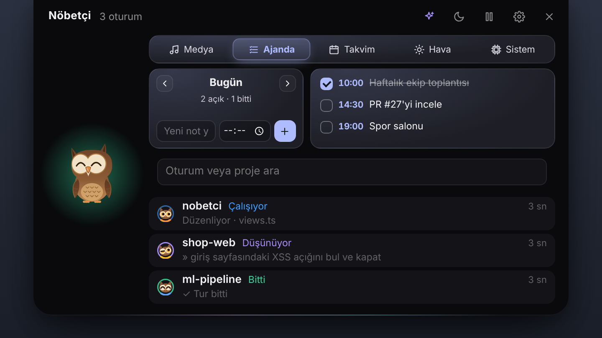
  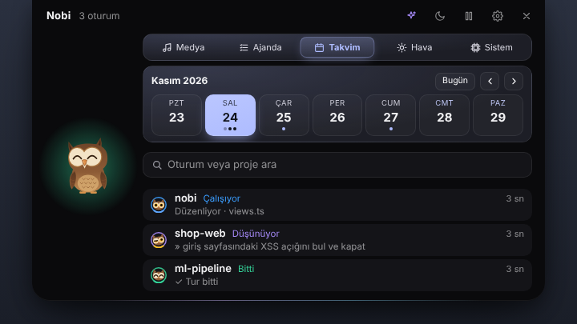
  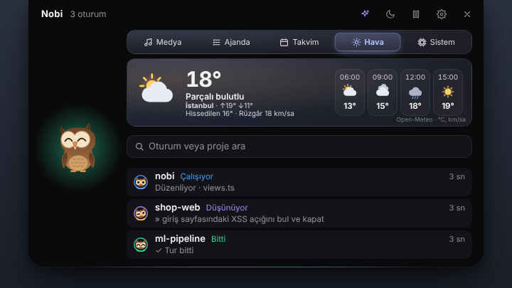
  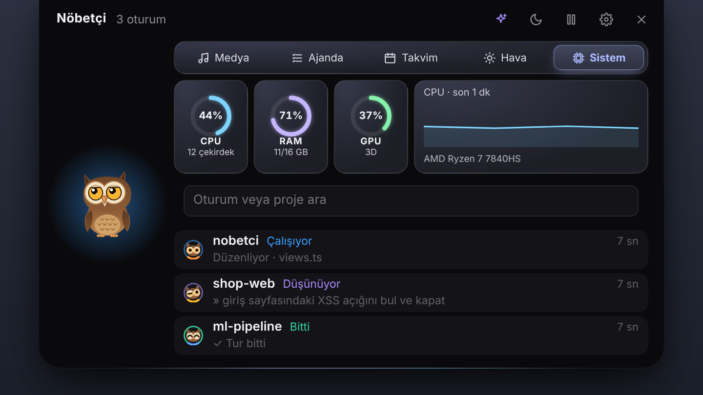
</p>

- **Claude Code her yerde.** Terminalden, VS Code'dan ve **Claude masaüstü uygulamasının Code sekmesinden** açılan oturumlar adada görünür; kart her birinin nerede çalıştığını söyler. Masaüstü uygulaması Claude Code'un `PermissionRequest` kancasını hiç çalıştırmadığından Nobi orada komutlar, düzenlemeler, web istekleri ve MCP araçları için `PreToolUse` üzerinden sorar — ekranın başında kimse yokken bunun bedeli için bkz. [Claude Code'u asla rehin tutmaz](#claude-codeu-asla-rehin-tutmaz).
- **Sorular ve planlar adada.** Claude çoktan seçmeli bir soru sorduğunda ya da planını onayına sunduğunda kart adada açılır: bir cevap seç (ya da kendin yaz), planı onayla ya da notla geri gönder.
- **Ne değişti, ne kadar kaldı.** Oturum ekranı her oturumun düzenlediği dosyaları eklenen ve silinen satır sayısıyla listeler; farkı bir tık uzakta. İsteğe bağlı durum satırıyla bağlam kullanımını, maliyeti, 5 saatlik ve haftalık plan limitlerini de gösterir.
- **Yedi maskot.** Baykuş, kurt, şahin, ahtapot, aslan, kanarya ve kartal aynı şekilde hareket eder ve tepki verir: izin isteğinde el sallar, riskli istekte kabarır, oturum bitince zıplar, çalışan bir şey yokken uyuklar. Maskotu **Ayarlar → Genel → Görünüm** bölümünden seç; kart renkleri ve geçişler de ona göre değişir. Tepkileri web demosunda deneyebilirsin.

<p align="center">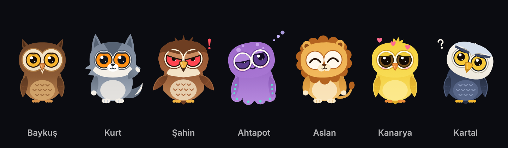</p>

- **Masaüstünde bir maskot.** Maskotu fareyle ekranın istediğin yerine sürükle; bıraktığın yerde kalır, taşırken kanatlarını açar, bırakınca zıplayarak konar. Adanın ruh hâlini taşır, tıklayınca dürtülür, çift tıklayınca adayı açar. **Ayarlar → Genel → Masaüstü maskotu** bölümünden ya da tepsi menüsünden açıp kapatabilirsin. Yalnızca gösterir; kararlar yine adadaki kartta verilir.
- **Her karar yüzüne yansır.** Onaylayınca maskot gülümser, iki kez başını sallar, kanatlarını kaldırıp zıplar; parıltılar içinde yeşil bir tik kendini çizer. Reddedince kaşlarını çatar, kulaklarını geri yatırır, başını iki yana sallar ve kırmızı bir çarpı belirirken burnundan soluyarak hırslanır.

<p align="center">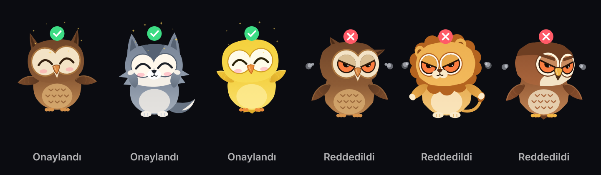</p>

<p align="center">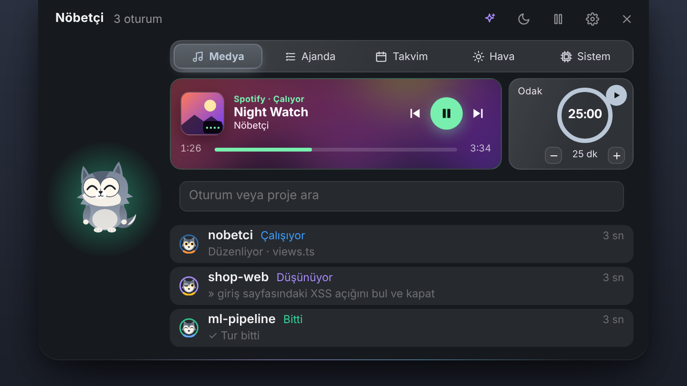</p>


Nobi, ekranının üst kenarında siyah bir adada yaşayan küçük bir baykuş. Claude Code, Codex ve
Cursor oturumlarını ve gönderilen mesajları izler; desteklenen izin isteklerini adaya taşır.
Claude Code tam risk incelemesine sahiptir; Codex ve Cursor desteği her ajanın hook yeteneklerine
bağlıdır. Ne çalışacağını ve riskini görüp doğru terminali aramadan karar verirsin.

<p align="center">
  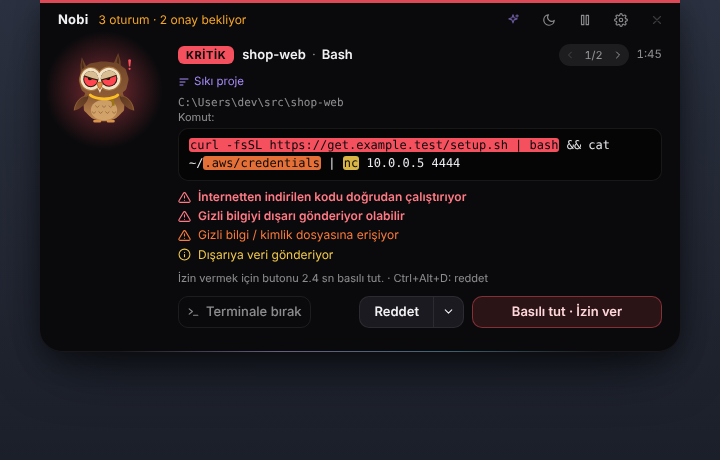
</p>

## Neden

Claude Code bir komut çalıştırmadan, dosya yazmadan ya da bir araç çağırmadan önce sorar. Ama
terminalde sorar: o an bakmadığın terminalde ya da yan yana çalışan dördünden birinde. Sonuçta
sorular ya fark edilmeden bekler ya da refleksle onaylanır — üstelik terminaldeki bir soruda
`npm test` ile `curl … | bash` birbirinin aynısı görünür.

Nobi bu kararı her zaman görebileceğin tek bir yere taşır. Her isteği dikkatli bir gözden
geçirici gibi okur, göze batanı ve nedenini söyler; tehlikeli olanlarda tek tıklama yetmez,
butonu bilerek basılı tutman (Linux'ta ise terminalde cevap vermen) gerekir. Sana ihtiyaç
olmadığında ekranın üst kenarına çekilir.

## Özellikler

### 👁 İzle

- **Her oturum ayrı satırda.** Paralel Claude Code oturumları — Windows Terminal'de,
  Terminal.app'te, iTerm2'de, VS Code'da, Cursor'da ya da başka bir yerde — kendi satırında görünür: ne yapıyor, ne zamandır, bitti mi,
  hata mı verdi, seni mi bekliyor.
- **Oturum detayı.** Son adımların zaman çizelgesi, etkin alt ajanlar, sayaçlar (araç, izin, ret, otomatik karar) ve
  oturumun terminalini ya da editörünü öne getiren **Pencereye git**.
- **Sadece gerektiğinde açılır.** İzin isteği, hata ya da Claude'un bir sorusu adayı açar;
  istersen biten oturum da. Geri kalan zamanda yoluna çıkmaz.
- Ada açık değilken (kompakt hap da görünmüyor sayılır) **masaüstü bildirimleri**, kodla
  sentezlenen sesler ve ruh hali işe göre değişen bir baykuş — üç dakika sakin geçince uyuklar ve
  ada çizim yapmayı tamamen bırakır.

### ✋ Karar ver

- **Risk puanlı onay kartları.** Her istek DÜŞÜK, ORTA, YÜKSEK ya da KRİTİK olarak puanlanır;
  gerekçeler listelenir, komutun riskli kısmı vurgulanır.
- **Ne görüyorsan o çalışır.** Kart komutun, dosya yolunun, URL'nin ya da MCP argümanlarının
  tamamını gösterir. Görünmez ve yön değiştiren Unicode karakterleri `⟦U+202E⟧` gibi işaretlere
  dönüşür, uzun boş satır ve boşluk dizileri `⟦40 boş satır⟧` gibi işaretlerle kısaltılır; bütün
  olarak taşınamayacak kadar uzun bir istek işaretlenir ve YÜKSEK sayılır — asla sessizce
  kesilmez.
- **Tehlikeliye basılı tutarak izin.** YÜKSEK ve KRİTİK isteklerde "İzin ver" butonunu basılı
  tutman gerekir (varsayılan 1,2 sn ve 2,4 sn). Bu kural sadece arayüzde değil, Rust tarafında
  uygulanır. Linux'ta bir programın sahte tıklaması gerçeğinden ayırt edilemediği için bunlar
  terminalde onaylanır: kartları **Terminale bırak** ve **Reddet** sunar.
- **Kazara onay yok.** Yeni açılan bir kart bir an tıklama kabul etmez; böylece bir karta
  yönelik çift tıklama ya da basılı tutmanın bırakılışı sıradaki kartı onaylayamaz.
- **Gerekçeyle reddet.** Claude gerekçeni okur ve başka bir yoldan devam eder; **Reddet ve
  Claude'u durdur** ayrıca turunu da bitirir. **Terminale bırak** kararı Claude Code'un kendi
  sorusuna geri verir.
- **Küçükleri tek seferde.** İki ya da daha fazla DÜŞÜK riskli istek beklerken bir satır onları listeler; satırdaki **Hepsine izin ver** düğmesi tam olarak bu istekleri tek bir gerçek tıklamayla geçirir. DÜŞÜK'ün üstündeki her istek, bir de risk motorunun kendisinin DÜŞÜK'ün üstünde bulup bir kuralın düşürdüğü her istek kendi kartında kalır.
- **Yığılma değil, kuyruk.** Aynı anda gelen istekler sıraya girer — en fazla altı tane; fazlası
  terminale düşer, hiçbiri kaybolmaz.

### 🧭 Kontrol sende

- **Kendi kuralların.** Araca, desene (içerir, ile başlar, tam eşit, glob ya da regex) ve proje
  klasörüne göre eşleştir; izin ver, reddet, her zaman sor ya da riski yeniden puanla. Kurallar
  Rust'ta çalışır, ilk eşleşen kazanır, yerleşik test alanı sonucu kaydetmeden önce gösterir.
- **Proje güveni.** Klasörleri güvenilir (DÜŞÜK istekler kendiliğinden geçer), normal ya da sıkı
  (her istek bir seviye yüksek sayılır) olarak işaretle.
- **Otomasyona kesin bir tavan.** Kurallar, güvenilir projeler ve oturum izinleri kendi başına en
  fazla DÜŞÜK (varsayılan) ya da ORTA riske kadar onay verebilir; istersen hiç veremez. **YÜKSEK ve KRİTİK
  asla sensiz onaylanmaz.**
- **Geçmiş ve denetim kaydı.** Her izin isteği, riski, kararı ve kararı kimin verdiği: sen,
  kısayol, toplu onay, kural, güvenilir proje, oturum izni, zaman aşımı ya da istek geri
  verildiyse terminal, Cursor veya Claude uygulaması. Arama,
  filtreler, grafikler, CSV ve JSON dışa aktarma.
- **Gerektiğinde sessiz.** Rahatsız etme, sessiz saatler ve tam ekran bir uygulama öndeyken
  kendiliğinden sessizlik. İstekler yine sıraya girer; hiçbir şey açılmaz, ses çıkmaz.
- **Her ajan için Mesaj Atölyesi.** Claude Code, Codex, Cursor, ChatGPT, Gemini ya da başka bir hedef
  seç; varsayılan yerel Ollama ile yazımı ve açıklığı düzelt veya OpenAI API'sini açıkça seç. Sonucu
  inceleyip kendin kopyala — hiçbir ajana otomatik gönderilmez.
- **Ve dahası.** Genel kısayollar, gerçek relay üzerinden hook sağlık testi, hangi hook
  olaylarının dinleneceğini seçme, risk kategorilerini tek tek kapatma, adanın konumu, ayarları
  içe ve dışa aktarma (içe aktarma yalnızca Nobi'nin kendi ayar dosyalarını kabul eder; içe
  aktarma da sıfırlama da yerini aldıkları ayarların tarihli bir kopyasını saklar); sistem diline
  göre kendiliğinden Türkçe ya da İngilizce arayüz.

### 🔒 Gizlilik

- **Telemetri yok, hesap yok.** Açıkça istediğin mesaj incelemesi, **Burada** ile sorduğun asistan
  sorusu ve şehir seçtiğinde hava durumu kartı dışında Nobi ağ isteği yapmaz. Bir yapay zekâ
  uygulamasına mesaj göndermek o uygulamayı ya da tarayıcını açar; Nobi kendisi bir şey
  göndermez — ama web'deki ChatGPT, Claude, Perplexity, Copilot ve Grok için mesaj sayfa adresinin
  içindedir: servis onu sayfa açılırken alır, tarayıcı geçmişin de saklar. Ollama varsayılan olarak
  yerel servisini kullanır; **cloud** etiketli Ollama modelleri taslağı dışarı iletebilir. OpenAI
  yalnızca onu seçip **Mesajı iyileştir** dediğinde taslağı alır. İsteğe bağlı API anahtarı işletim
  sisteminin güvenli parola kasasında durur.
- **Veriler yerel.** Ayarlar, geçmiş ve kayıt dosyası JSON, JSON Lines ve düz metindir. Taslaklar ve
  düzenlenmiş mesajlar geçmişe kaydedilmez.
- **Sırlar kayda geçmez.** API anahtarları, token'lar, parolalar ve özel anahtarlar, istek geçmişe
  yazılmadan ya da bildirimde gösterilmeden önce maskelenir. Onay kartı ise isteği her
  zaman eksiksiz gösterir.

Ayrıntılar için [Gizlilik Politikası](PRIVACY.md) sayfasına bak.

### Kod imzalama politikası

Ücretsiz kod imzalama [SignPath.io](https://signpath.io) tarafından, sertifika
[SignPath Foundation](https://signpath.org) tarafından sağlanmaktadır. Şimdiye kadarki sürümlerin
hiçbiri (v2.5.0 dahil) kod imzalı değil: başvuru kabul edilip imzalama açılınca Windows sürümleri
imzalı çıkar ve her sürümün notları dosyalarının imzalı olup olmadığını söyler. O zamana kadar her
indirdiğin dosyayı `SHA256SUMS.txt` ile doğrula. Neyin imzalandığı, bir sürümün nasıl onaylandığı ve
kimin onayladığı: [Kod imzalama politikası](CODE_SIGNING_POLICY.md).

## Nasıl çalışır

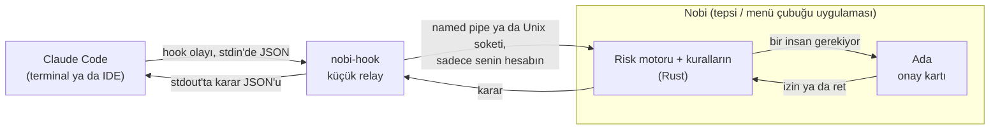

Claude Code, Nobi'nin kayıtlı olduğu her hook olayında relay'i (`nobi-hook`) çalıştırır.
Relay olayı sadece senin hesabının açabildiği bir kanaldan iletir — Windows'ta bir named pipe,
macOS'ta Library klasöründeki, Linux'ta `~/.local/state/nobi` altındaki bir Unix soketi — ve
çıkar. Yanıt bekleyen tek olay izin isteğidir: risk motoru onu puanlar, ilk sözü kuralların söyler;
bir kural, güvenilir bir proje ya da oturum izni kararı anında verebilir. Gerisi adada bir karta
dönüşür, senin kararın da aynı yoldan geri döner. Codex ve Cursor da kendi hook'larıyla aynı
relay'i kullanır.

### Claude Code'u asla rehin tutmaz

| Durum | Ne olur |
| --- | --- |
| Nobi çalışmıyor | Relay dinleyen kimseyi bulamaz, hiçbir çıktı vermeden hemen çıkar ve Claude Code her zamanki gibi terminalde sorar. Windows'ta var olan ama meşgul bir pipe için en fazla **300 ms** bekler. |
| Ada kartı gösteremiyor | Uygulama, kartın ekranda ya da sırada olduğunu doğrulaması için adaya **800 ms** tanır. Doğrulama gelmezse istek terminale döner. |
| Kimse yanıt vermiyor | Uygulama **108 sn**, relay **110 sn** sonra bırakır (hook'un kendisi 120 sn zaman aşımıyla kayıtlıdır). Ardından Claude Code terminalde sorar. |
| Duraklatıldı ya da sırada zaten altı istek var | Yeni istekler doğrudan terminale gider. |
| Diğer bütün hook olayları | Gönder ve unut: bağlan, yaz, çık — kesin bir 2 sn bütçeyle. |
| Cursor'da Nobi cevap vermiyor | Nobi kapalı ya da duraklatılmışsa, isteği geri verdiysen, sıra doluysa ya da süre dolduysa relay "sor" (ask) cevabı verir ve Cursor sana kendisi sorar. Ama Nobi'nin Cursor izin hook'ları güvenli tarafta kapanır (fail-closed): relay hiç çalışamazsa (örneğin klasörü silindiyse) Cursor, hook'lar kaldırılana kadar kabuk ve MCP komutlarını engeller. |
| Claude masaüstü uygulaması | `PermissionRequest` hook'unu hiç çalıştırmadığı için Nobi, uygulamanın kendi denetiminden önce gelen `PreToolUse` üzerinden sorar. Soru sorabilecek her komut, düzenleme, web isteği ve MCP çağrısı adayı bekler; **Claude izin kurallarının zaten izin verdikleri de dahil**. Kimse cevap vermezse uygulamanın kendi davranışı en fazla **108 sn** sonra devreye girer. Bir masaüstü oturumunu başında kimse olmadan çalışmaya bırakmadan önce Nobi'yi tepsiden duraklat (istekler o zaman doğrudan geri döner) ya da DÜŞÜK istekleri güvenilir bir proje veya kurallarla geçir. |

## Kurulum

> 📖 [Kurulum kılavuzu](docs/kurulum.md) her adımı, güncellemeyi, kaldırmayı ve sorun gidermeyi
> ayrıntılı anlatır.

Nobi **Windows 10 ve 11**'de (64 bit), **macOS 11 ya da üstünde** (Apple Silicon ve Intel) ve
**Linux**'ta (x86-64, X11 ya da Wayland) çalışır. Aynı sistemde çalışan
[Claude Code](https://code.claude.com/docs/en/overview) gerekir — WSL ya da bir konteyner içindeki
Claude Code ayarlarını başka bir yerde tutar, kapsam dışıdır.

Aşağıda `x.y.z`, indirdiğin sürümün yerini tutar. 2.4.1'den sonraki sürümler her dosyayı adında
sürüm olmadan da taşır (`Nobi-setup.exe`, `Nobi-macos-universal.dmg`,
`Nobi-linux-amd64.deb`, `Nobi-linux-amd64.AppImage`); bunlar da `SHA256SUMS.txt` içinde
listelenir.

### Windows

Microsoft Edge WebView2 Runtime Windows 11'de ve güncel Windows 10'da zaten vardır; yoksa kurulum
programı onu indirir.

1. [Son sürümden](https://github.com/tahap0l/nobi/releases/latest) `Nobi-x.y.z-setup.exe` ve
   `SHA256SUMS.txt` dosyalarını indir.
2. Kurulum dosyasının yayımlanan dosyanın kendisi olduğunu doğrula:

   ```powershell
   Get-FileHash .\Nobi*setup.exe -Algorithm SHA256
   Get-Content .\SHA256SUMS.txt
   ```

   İki hash birebir aynı olmalı (büyük ya da küçük harf fark etmez).
3. Kurulumu çalıştır. Sadece senin Windows hesabın için, `%LOCALAPPDATA%\Nobi` klasörüne
   kurulur ve yönetici izni istemez. Kurulum programı Türkçe Windows'ta Türkçe, diğer her dilde
   İngilizce konuşur. Sessiz kurulum için `/S` ekle.

> [!NOTE]
> **"Windows bilgisayarınızı korudu" uyarısı mı çıktı?** Sürümler henüz kod imzalı değil, bu
> yüzden yeni bir kurulum dosyasının SmartScreen'de itibarı olmaz. Hash'i doğruladıktan sonra
> **Ek bilgi → Yine de çalıştır**'ı seç. İmzalı sürümler [yol haritasında](#yol-haritası).

### macOS

1. [Son sürümden](https://github.com/tahap0l/nobi/releases/latest)
   `Nobi-x.y.z-macos-universal.dmg` ve `SHA256SUMS.txt` dosyalarını indir.
2. Disk görüntüsünü Terminal'de doğrula:

   ```sh
   shasum -a 256 ~/Downloads/Nobi-x.y.z-macos-universal.dmg
   cat ~/Downloads/SHA256SUMS.txt
   ```

3. Disk görüntüsünü aç ve baykuşu **Uygulamalar** (Applications) klasörüne sürükle. (Finder onu
   Nobi ya da Nobi diye gösterebilir; diskte her zaman `/Applications/Nobi.app` olarak
   durur.)
4. Uygulamalar'dan aç. Uygulama henüz Apple tarafından onaylanmadığı (notarize edilmediği) için
   macOS ilk seferde açmayı reddeder: **Bitti**'yi seç, sonra **Sistem Ayarları → Gizlilik ve
   Güvenlik**'e git, uygulamanın engellendiğini söyleyen satıra in ve **Yine de Aç**'a tıkla.
   (macOS 14 ve öncesinde uygulamaya Control tuşuyla tıklayıp **Aç → Aç** demek de olur.)

Nobi menü çubuğunda yaşar, Dock'ta simgesi olmaz. Ayrıntılar
[kurulum kılavuzunda](docs/kurulum.md#macos).

### Linux

Nobi X11'de ve XWayland üzerinden Wayland masaüstlerinde (GNOME, KDE Plasma, Xfce, Cinnamon…)
çalışır. Güncel Ubuntu, Debian, Fedora ve Arch'ın getirdiği WebKitGTK 4.1 ve — X11'de — bir
bileşikleştirici (compositor) gerekir, çünkü ada saydam bir penceredir. GNOME, KDE Plasma ve
Cinnamon bunu kendileri yapar; Xfce'de pencere yöneticisinin ince ayarlarındaki (**Window Manager
Tweaks**) **Compositor** sekmesinden bileşikleştirmeyi aç, yalın bir pencere yöneticisinde `picom`
gibi bir bileşikleştirici çalıştır. Yoksa Nobi penceresini adanın kendisine kırpar (köşeler kare,
gölge yok; 2.4.1'e kadar ekranın üstünde siyah bir kutu görünüyordu), masaüstü maskotunun penceresini
de maskota ve çevresindeki dar bir kenara kırpar (2.4.1'e kadar siyah bir karenin üstünde duruyordu);
ikisinin de tam görünümü için bir bileşikleştirici gerekir.

1. [Son sürümden](https://github.com/tahap0l/nobi/releases/latest)
   `Nobi-x.y.z-linux-amd64.deb` (Debian, Ubuntu, Mint…) ya da
   `Nobi-x.y.z-linux-amd64.AppImage` (her dağıtım) ve `SHA256SUMS.txt` dosyalarını indir.
2. İndirdiğini doğrula (indirdiğin her dosya için `OK` yazmalı):

   ```sh
   sha256sum --check --ignore-missing SHA256SUMS.txt
   ```

3. Paketi `sudo apt install ./Nobi-x.y.z-linux-amd64.deb` ile kur ya da AppImage'ı
   çalıştırılabilir yap (`chmod +x Nobi-*.AppImage`) ve aç.

Nobi sistem tepsisinde yaşar. GNOME'da tepsi için *AppIndicator* eklentisi gerekir (Ubuntu'da
zaten var). Relay soketi `~/.local/state/nobi/nobi.sock`, ayarlar `~/.config/nobi`,
geçmiş `~/.local/share/nobi` altındadır.

Bir **Wayland** oturumunda (güncel Ubuntu, Fedora ve KDE Plasma'nın varsayılanı) Nobi'nin
penceresi XWayland'de çalışır ve üç özellik yalnız X11 pencerelerini görür: genel kısayollar yalnız
bir X11 penceresi odaktayken çalışır, **Pencereye git** doğrudan Wayland'de çalışan terminalleri
bulamaz (onun yerine oturumun klasörünü açar) ve tam ekranda sessizlik yerel Wayland uygulamalarını
fark etmez. Nobi'nin senin için açtığı programlar — bağlantılar, VS Code, dosya yöneticisi — yine
doğrudan Wayland'de açılır. Ayrıntılar [kurulum kılavuzunda](docs/kurulum.md#linux).

**Linux'ta YÜKSEK ve KRİTİK istekler terminalde onaylanır.** X11, senin hesabınla çalışan her
programın gerçek fare üzerinden tıklamasına izin verir ve böyle bir tıklamayı seninkinden ayıran
hiçbir şey yoktur; bu yüzden ada orada yalnızca DÜŞÜK ve ORTA istekleri onaylar. YÜKSEK ya da
KRİTİK bir kart nedenini söyler ve **Terminale bırak** (Cursor isteğinde **Cursor'a bırak**) ile
**Reddet** sunar.

### Kaynaktan derleme

[Rust](https://rustup.rs) (MSVC araç zinciriyle), Node.js 22 ya da üstü ve "Desktop development
with C++" iş yüküyle [Visual Studio Build Tools](https://visualstudio.microsoft.com/visual-cpp-build-tools/)
gerekir.

```powershell
git clone https://github.com/tahap0l/nobi.git
cd nobi
npm ci
npm test         # önce relay'i derler, sonra Rust testleri: risk motoru, kurallar, relay, geçmiş…
npm run pack     # → release\Nobi-<sürüm>-setup.exe
```

Mac'te Xcode Command Line Tools (`xcode-select --install`), iki Apple hedefiyle Rust
(`rustup target add aarch64-apple-darwin x86_64-apple-darwin`) ve Node.js 22 ya da üstü gerekir;
`npm run pack:mac`, `release/Nobi-<sürüm>-macos-universal.dmg` dosyasını üretir.

Linux'ta Rust, Node.js 22 ya da üstü ve WebKitGTK geliştirme paketleri gerekir (Debian ve
Ubuntu'da `sudo apt install libwebkit2gtk-4.1-dev libayatana-appindicator3-dev librsvg2-dev libxi-dev libxdo-dev libdbus-1-dev libssl-dev`);
`npm run pack:linux` `.deb` ve AppImage üretir. AppImage, derleyen makinede kurulu GStreamer
eklentilerini taşır; bu yüzden önce
`gstreamer1.0-plugins-base gstreamer1.0-plugins-good gstreamer1.0-pulseaudio gstreamer1.0-alsa`
ve `patchelf` paketlerini kur, yoksa AppImage'ın sesleri çalmaz.

## İlk çalıştırma

Nobi'yi Başlat menüsünden (Mac'te Uygulamalar'dan) aç. Baykuş ekranın üstünde — Mac'te menü
çubuğunun hemen altında — selam verir, ardından ada kenara çekilir ve Nobi bildirim alanından
(tepsiden; Mac'te menü çubuğundan) nöbetini sürdürür. İlk açılışta ayrıca kısa bir hoş
geldin sihirbazı açılır: dilini seç, Claude Code'a bağlan, sağlık testini çalıştır, güvenlik
temellerini ayarla, bitti. İstersen atlayabilirsin — sihirbazdaki her şey Ayarlar'da da var.

Nobi'nin Claude Code'u görebilmesi için hook'larının `~/.claude/settings.json` dosyasında
olması gerekir (Claude Code'un ayarlarını `CLAUDE_CONFIG_DIR` ile kendi seçtiğin bir klasörde
tutuyorsan ve Nobi de bu değişkeni görüyorsa `$CLAUDE_CONFIG_DIR/settings.json` dosyasında; hangi
dosyanın kullanıldığını **Ayarlar → Claude Code** gösterir). Sihirbazın **Claude Code'a bağlan** adımı — ya da istediğin
zaman **Ayarlar → Claude Code → Hook'ları kur…** — bunu dikkatle yapar:

- yapılacak değişikliği, dosyaya dokunulmadan önce fark (diff) olarak görürsün;
- dosyanın yanına önce tarihli bir yedek alınır (`settings.json.bak-YYYYMMDD-HHMMSS`);
- diğer ayarların ve başka araçların hook'ları olduğu gibi kalır;
- sen tıklamadan hiçbir şey yazılmaz; önizlemeyle tıklaman arasında dosya değişirse Nobi
  yazmayı reddeder ve sana yeni farkı gösterir.

<p align="center">
  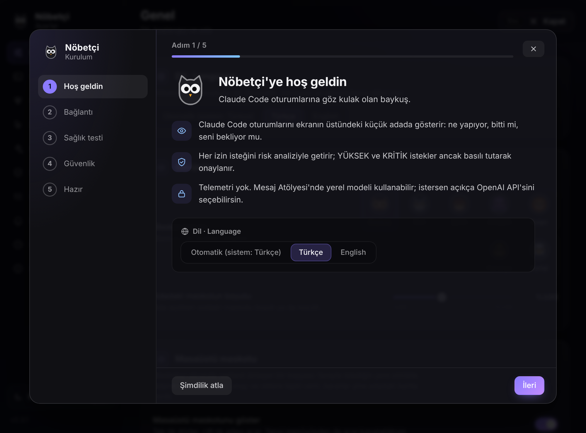
</p>

Ardından **Ayarlar → Claude Code** sayfasında **Sağlık testi**'ne bas: relay'i tam Claude Code'un
çalıştırdığı gibi çalıştırır ve bir ping'in gidiş-dönüş süresini ölçer. Claude
Code hook'ları oturum başlarken okur; o sırada açık olan oturumları yeniden başlat.

Yerel ChatGPT Work ve Codex'i bağlamak için **Ayarlar → ChatGPT**, Cursor için **Ayarlar → Diğer
ajanlar** sayfasını aç. **Bağla…** ile ayar dosyasındaki farkı incele ve onayla. Ardından
ChatGPT masaüstü uygulamasında **Ayarlar → Hooks** bölümünde Nobi hook'larını inceleyip
güvenilir olarak işaretle. Liste boşsa Codex görünümünde yerel bir proje ekleyip listeyi yenile.
Codex CLI'da bunun için `/hooks` komutunu kullan. **Sağlık testi**, relay testini ve Codex'ten gelen
son olayı ayrı ayrı gösterir. Windows eski girdiler bildirirse **Bağlantıyı güncelle…**'yi seç ve
değişen hook'ları ChatGPT'de ya da Codex'te yeniden inceleyip güvenilir olarak işaretle. Teslimi
doğrulamak için yeni bir yerel sohbette mesaj gönder ve **Sağlık testi**'ni yeniden çalıştır. Work
Cloud yerel hook'ları çalıştırmaz.
Yerel Work ve Codex'te gönderilen mesajlar ve desteklenen izin istekleri aynı hook'ları kullanır.
Cursor'da gönderilen mesajlar ile kabuk/MCP istekleri izlenir. Nobi bir Cursor isteğine cevap
vermezse (kapalı ya da duraklatılmışsa, isteği geri verdiysen ya da süre dolduysa) Cursor sana
kendisi sorar; Cursor'un komutu engellemesi yalnız relay hiç çalışamadığında olur, çünkü izin
hook'ları güvenli tarafta kapanacak (fail-closed) biçimde kuruludur. Mesajlar oturum akışında
görünür; ajan hook'ları gönderilen metni alıcıya ulaşmadan değiştiremez.

## Kullanım

### Ada

<p align="center">
  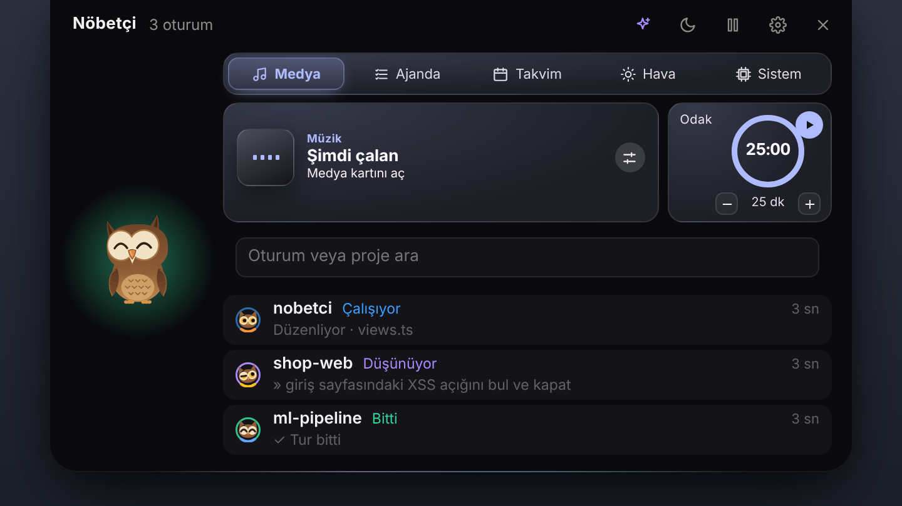
</p>

- **Gizli** — üst kenarda ince, görünmez bir şerit. Fareyi oraya götürünce ada uyanır.
- **Kompakt** — tek satır durum ("2/3 çalışıyor", "Onay bekliyor — tıkla") ve her oturum için
  mini bir baykuş taşıyan küçük siyah bir hap. Tıklayınca açılır.
- **Açık** — oturumların, bir oturumun detayı, asistan ya da onay kartı. Fare çıktıktan 15 sn
  sonra (ayarlanabilir) küçülür; bekleyen bir istek varken asla.

<p align="center">
  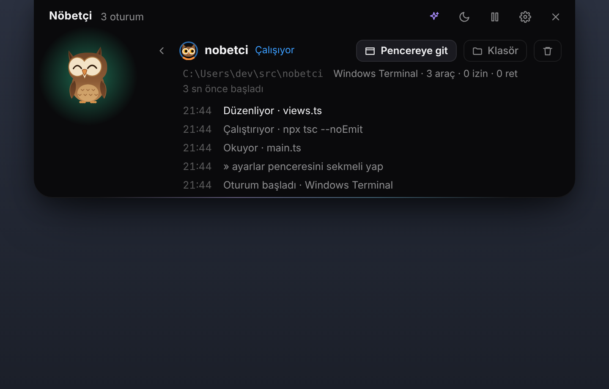
  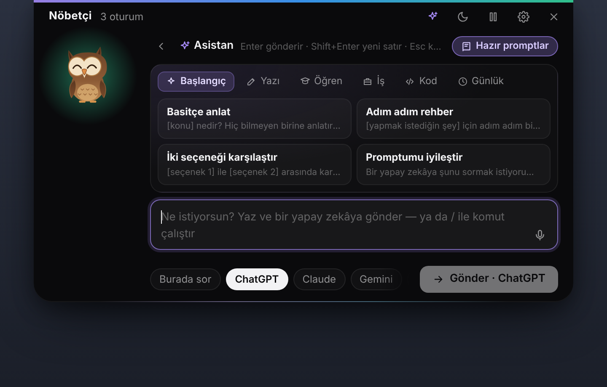
</p>

Bir oturumun satırına tıklayınca detayı açılır: son adımların zaman çizelgesi, farklarıyla
değiştirdiği dosyalar, sayaçlar ve **Pencereye git**. Asistan `Ctrl+Alt+Space` ya da ✦ düğmesiyle
açılır; Esc, ✕ ya da kısayol onu yeniden kapatır.

Ada klavyeyi almaz: ona ya da masaüstü maskotuna tıklamak terminalini ya da editörünü etkin bırakır;
Windows'ta ikisi de Alt-Tab'da görünmez. Klavyeyi yalnızca adanın yazı kutuları — asistan, oturum
araması, ajanda ve soru ile plan kartlarındaki cevap ve not kutuları — sen içlerine yazarken alır.

Tepsi simgesinde (Mac'te menü çubuğu simgesinde) **Nobi'yi aç**, **Ayarlar…**, **Duraklat /
devam et**, **Rahatsız etme aç / kapat**, **Masaüstü maskotu aç / kapat** ve **Çıkış** var.
Duraklatmak bekleyen her isteği terminale geri verir ve bunu oturumun zaman çizelgesine yazar.
Gizli bir ada neredeyse hiç kaynak harcamaz: animasyon döngüsü durur, imleç takibi uykuya geçer.

### Onay kartı

<p align="center">
  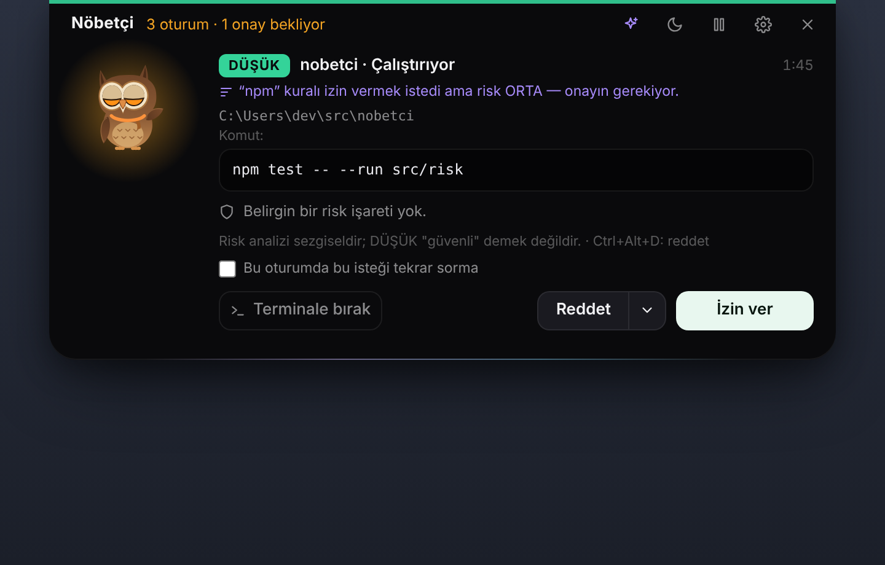
</p>

- **Başlıkta** risk seviyesi, oturum ve araç (MCP aracında sunucusu da), sıradaki yerin ve
  terminalin devralmasına kalan süre görünür. Birden fazla istek bekliyorsa sayının yanındaki
  oklarla, cevap vermeden diğerlerine bakabilirsin.
- **İstek** eksiksiz gösterilir — komut, yazılacak içerikle birlikte dosya yolu (çoklu
  düzenlemenin her düzenlemesi), URL ya da MCP argümanları — ve her bulgunun dayandığı kısım
  vurgulanır. Kutu kaydırılacak kadar uzunsa bunu söyler. Bütün olarak taşınamayacak kadar uzun bir
  istek kesildi diye işaretlenir ve YÜKSEK sayılır.
- **Bulgular** her gerekçeyi seviyesiyle listeler; varsa kural ya da proje notu da çıkar ("Sıkı
  proje" ya da izin vermek isteyip tavana takılan bir kural gibi).
- **İzin ver**, DÜŞÜK ve ORTA için tek tıklamadır. YÜKSEK ve KRİTİK'te buton **Basılı tut · İzin
  ver** olur: çubuk dolana kadar basılı tut. Onay gerçek bir fare tıklaması ister; Enter ya da
  Boşluk tuşu yetmez. Linux'ta YÜKSEK ya da KRİTİK bir kartta İzin ver yoktur: kart nedenini
  söyler; önce **Terminale bırak** (Cursor'da **Cursor'a bırak**), sonra Reddet gelir.
- **Reddet** isteği geri çevirir ve Claude'a söyler; Claude başka bir yoldan devam eder. Yanındaki
  ok, Claude'a iletilen hazır gerekçeleri (Ayarlar → Kurallar'dan düzenlenir) ve **Reddet ve
  Claude'u durdur**'u açar; bu ikincisi Claude'un turunu da bitirir, Claude seni bekler. Codex ve
  Cursor bir hook'tan durdurulamaz; bu yüzden onların kartları yalnızca gerekçeleri sunar.
- **Bu oturumda … için tekrar sorma** yalnızca otomatik izin tavanının izin verdiği yerde çıkar:
  varsayılan tavanda DÜŞÜK için, *DÜŞÜK + ORTA* tavanında DÜŞÜK ve ORTA için; tavan kapalıyken hiç
  çıkmaz. Kutu neyi kapsadığını söyler — tam olarak bu komut, bu dosyadaki değişiklikler, bu adres
  ya da aynı argümanlarla bu araç — ve o oturumda, Nobi yeniden başlayana kadar geçerlidir.
  Sonraki her istek yine puanlanır; tavanın üstündeki her şey sana geri gelir.
- **Terminale bırak**, soruyu Claude Code'un terminaline geri verir.

### Sorular, planlar ve toplu onay

<p align="center">
  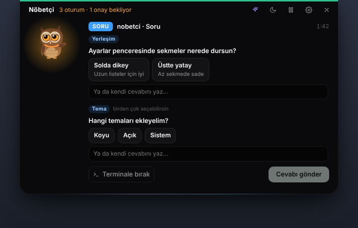
  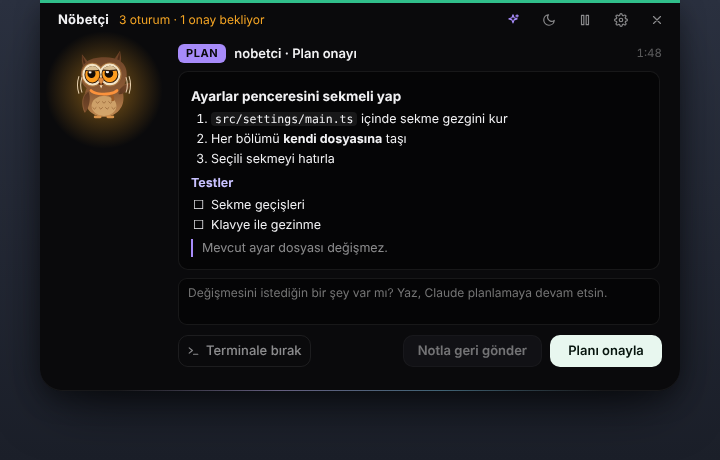
</p>

- **Sorular.** Claude çoktan seçmeli bir soru sorduğunda bir ya da birkaç seçenek seç veya kendi
  cevabını yaz ve gönder. Bunları yalnız sen cevaplarsın; hiçbir kural cevaplamaz.
- **Planlar.** Claude bir planı bitirdiğinde onu kartta oku ve **Planı onayla**'ya bas ya da neyin
  değişmesi gerektiğini yazıp **Notla geri gönder**: Claude notu okur ve planlamaya devam eder.
  İkisini de **Ayarlar → Claude Code → Sorular ve planlar**'dan kapatabilirsin.
- **Toplu onay.** İki ya da daha fazla DÜŞÜK istek beklerken bir satır onları listeler ve
  **Hepsine izin ver** seçeneğini sunar: tek bir gerçek tıklama tam olarak listelenen isteklere
  izin verir. Sorular, planlar ve DÜŞÜK'ün üstündeki hiçbir şey buna dahil olmaz. Geçmiş, bu
  yolla izin verilen istekleri **Toplu izin (düşük risk)** diye işaretler.

<p align="center">
  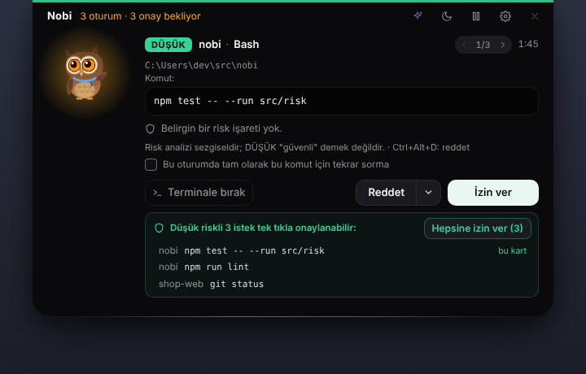
</p>

### Risk seviyeleri

| Seviye | Anlamı | Örnekler |
| --- | --- | --- |
| **DÜŞÜK** | Belirgin bir şey yok — bu "güvenli" demek *değildir*. | `npm test`, `git status`, `cargo build --release`, `src/main.ts`'yi düzenlemek, `rm old.log` |
| **ORTA** | Bir göz atmaya değer. | `git push origin feature`, `npm i -D left-pad`, `pip install requests`, `gh pr create`, proje klasörü dışına yazmak, `.github/workflows/ci.yml`'yi düzenlemek, `mcp__gmail__send_email` |
| **YÜKSEK** | Bilinçli, görünür ya da geri alması zor. Basılı tutarak izin. | `rm -rf node_modules`, `git push --force`, `git reset --hard`, `npm publish`, `schtasks /create …`, `certutil -urlcache …`, `~/.ssh/id_rsa` ya da `.env` okumak, `.git/hooks/pre-commit` ya da `.mcp.json` yazmak, görünmez Unicode karakterleri |
| **KRİTİK** | Geri dönüşü yok ya da klasik bir saldırı kalıbı. Daha uzun basılı tutma. | `curl … \| bash`, `irm … \| iex`, `powershell -enc …`, `Set-MpPreference -DisableRealtimeMonitoring $true`, `vssadmin delete shadows`, `rm -rf ~`, `gh repo delete`, `~/.claude/settings.json` yazmak, aynı istekte bir sırrı okuyup dışarı göndermek |

Linux'ta YÜKSEK ve KRİTİK istekler basılı tutmayla değil, terminalde onaylanır (bkz.
[Linux](#linux)). İngilizce arayüzde seviyeler LOW, MEDIUM, HIGH ve CRITICAL olarak geçer.

<details>
<summary><b>Risk motoru neye bakar</b></summary>

**Komutlar** (Bash ve PowerShell)

- **KRİTİK** — internetten inen kodu doğrudan çalıştırmak (`curl … | sh`, `bash -c "$(curl …)"`,
  `bash <(curl …)`, `iex (irm …)`); kodlanmış ya da base64 ile gizlenmiş komutlar; Defender'ı ya da
  güvenlik duvarını kapatmak, gölge kopyaları ya da olay günlüklerini silmek, `bcdedit`; macOS'ta
  Gatekeeper'ı (`spctl --master-disable`), SIP'i, uygulama güvenlik duvarını ya da karantinayı
  kapatmak, gizlilik izinlerini sıfırlamak (`tccutil reset`) ya da birleşik günlüğü silmek; diski
  biçimlendirmek ya da üzerine yazmak (`diskutil erase…` dahil); ev dizinini, bir sürücüyü ya da
  kökü silmek; bir GitHub deposunu silmek ya da herkese açmak; Claude Code'un izin ya da hook
  ayarlarını, Codex'in ya da Cursor'un hook ayarlarını değiştirmek; Nobi'nin kendi dosyalarını,
  programlarını ya da relay'ini değiştirmek — Windows'ta, macOS'ta ve Linux'ta, yazma işini hangi
  komut yaparsa yapsın; Nobi'nin hook'larını kaldırmak (`nobi --remove-hooks`); SSH
  `authorized_keys`'e dokunmak.
- **YÜKSEK** — Nobi'yi kapatmaya ya da kaldırmaya çalışmak; özyinelemeli silme; zorla push,
  işlenmemiş değişiklikleri atan git komutları (`git restore .`, `git checkout -f`,
  `git clean --force`) ve geri alınamaz diğer git işlemleri; paket ya da sürüm yayınlamak; `sudo`,
  `doas`, `pkexec`, `su`, `runas`, `gsudo` ve AppleScript'in `with administrator privileges`'ı;
  kalıcılık (zamanlanmış görevler, Run anahtarları, servisler, başlangıç klasörleri, cron ve
  `crontab`, kullanıcı birimleri dahil systemd, LaunchAgents ve LaunchDaemons, oturum açma
  öğeleri); macOS karantina işaretini kaldırmak
  (`xattr -d`); macOS anahtar zincirini okumak (`security find-generic-password`,
  `dump-keychain`); başka pencerelere sahte tıklama ya da tuş gönderen programlar (`xdotool`,
  `ydotool`, `xte`, `xinput create-master`, XTest ya da uinput yükleyen bir betik); `mshta`, `regsvr32 /i:`, `certutil -urlcache`
  ya da `bitsadmin /transfer` gibi şüpheli yerleşik Windows araçları; PowerShell betik
  politikasını devre dışı bırakmak; kimlik ve sır dosyaları — bir programa `--env-file` ile
  yüklenen `.env` dahil (program yüklediğini ekrana yazdırabilir); bilinen veri sızdırma servisleri
  (paste siteleri, istek yakalayıcılar, tüneller, sohbet webhook'ları); aşırı geniş izinler
  (`chmod 777`, `icacls … Everyone:F`, `takeown`); bilgisayarı kapatmak ya da yeniden başlatmak; veritabanında veri
  silen komutlar; ayrıcalıklı ya da ana makineyi bağlayan Docker çalıştırmaları ve Docker
  temizlikleri; bulutta kaynak silmek (`terraform destroy`, `kubectl delete`, `aws … delete-…` ve
  benzerleri); GitHub API ile silmek; görünmez ya da yön değiştiren karakterler; uzun boş satır ya
  da boşluk dizileriyle gözden kaçırılan içerik.
- **ORTA** — dışarı veri göndermek (`curl -d`, `nc`, `scp`, uzak bir hedefe `rsync`, FTP,
  `Send-MailMessage`); ortam değişkenlerini dökmek; kayıt defteri değişiklikleri ve `setx`;
  süreç sonlandırmak; paket kurmak ya da paket deposundan indirip doğrudan çalıştırmak
  (`npm i`, `npx -y`, `pip install`, `winget install`, `brew install` …); dinamik kod (`iex`,
  `eval`, `python -c`, `node -e`, `osascript -e`); `git push`; PR ya da issue açmak, yorum yazmak, gist oluşturmak gibi GitHub'da
  herkesin göreceği işlemler; Claude Code ayarlarına dokunmak; çok uzun komutlar.
- **DÜŞÜK**, bağlam için — ağ erişimi, tek tek dosya silmek ya da taşımak, git geçmişini yeniden
  yazmak.

Komut, içinde kelime aranarak değil komut olarak okunur: `git commit -m "graceful shutdown"`,
`npm publish --dry-run`, `cat .env.example` ve `curl … | python3 -m json.tool` (indirileni
çalıştırmıyor, veri olarak okuyor) DÜŞÜK kalır. Dosya yazan bir komut — yönlendirme, `tee`, `cp`,
`curl -o`, `sed -i`, tek satırlık bir betik — o yola yapılan dosya yazımı gibi değerlendirilir.

**Dosya yazma** — yollar önce oturumun klasörüne göre çözülür; böylece `.claude//settings.json`,
`./.git/hooks/pre-commit` ya da `../../usr/local/bin/git` düz yazılışlarıyla aynı kurallara takılır,
`~/../../etc/cron.d/x` ya da `$HOME/../..` da gerçekte vardığı yere sayılır. Claude Code ayar
dosyaları (`~/.claude` içinde ya da `CLAUDE_CONFIG_DIR`'in gösterdiği klasörde), Codex'in ve
Cursor'un hook dosyaları, Nobi'nin kendi dosyaları ve `~/.ssh` altındaki her şey için KRİTİK;
Claude Code hook, agent, komut, skill ve eklentileri, `.mcp.json`, git hook'ları ve git ayarı, kabuk
profilleri, başlangıç klasörleri ve LaunchAgents, sistem dosyaları, sır dosyaları (macOS anahtar
zinciri dahil) ve özel anahtar ya da görünmez karakter içeren içerik için YÜKSEK; CI iş akışları,
`CLAUDE.md`, kurulum betikleri (`postinstall`), koda gömülmüş görünen sırlar ve proje klasörü
dışındaki her şey için ORTA; `package.json`, `Cargo.toml` ya da `Dockerfile` gibi build dosyaları
için DÜŞÜK. `.env.example` gibi şablonlar yol kurallarını tetiklemez.

**Dosya okuma** — sırlar için YÜKSEK (SSH anahtarları, `.env`, kimlik dosyaları, bulut ve
Kubernetes ayarları, tarayıcı çerezleri ve kayıtlı girişler).

**Web** — bilinen veri sızdırma servisleri için YÜKSEK, çıplak IP adresleri ve çok uzun sorgu
dizgileri için ORTA, şifresiz `http://` için DÜŞÜK.

**MCP araçları** — araç adının (sunucu adından sonraki) kelimelerine bakılır: silme, kaldırma,
çöpe atma, yok etme, düşürme, temizleme, sıfırlama, sonlandırma, iptal gibi bir şey söylüyorsa
(delete, remove, trash, destroy, drop, purge, wipe, terminate, revoke…) YÜKSEK; bir şey gönderiyor,
yayınlıyor, itiyor, oluşturuyor, güncelliyor, yüklüyor, ödüyor, dağıtıyor, taşıyor ya da
çalıştırıyorsa ORTA; gerisi DÜŞÜK. Argümanları da denetlenir: bir komut, bir URL, bir dosya yolu
ya da SQL (`execute_sql` çağrısındaki `DROP TABLE` YÜKSEK). Nobi'nin tanımadığı bir araç bütün
argümanlarıyla gösterilir ve eşleştirilir.

**Birleşimler** — aynı istekte bir sır ve dışarı giden bir yol varsa KRİTİK, sığması için kesilmek
zorunda kalınan bir istek YÜKSEK; motorun tamamını okuyamayacağı kadar karışık bir komut da YÜKSEK
(hepsini kendin kontrol et). Bu üçü kapatılamaz, onları oluşturan kategoriler kapatılsa bile; diğer
bütün kategoriler **Ayarlar → Güvenlik → Risk kategorileri**'nden tek tek kapatılabilir. Aynı
sayfada, her araç için bir isteği motorun yapacağı gibi puanlayan bir test alanı da var.

</details>

### Kurallar, proje güveni ve tavan

<p align="center">
  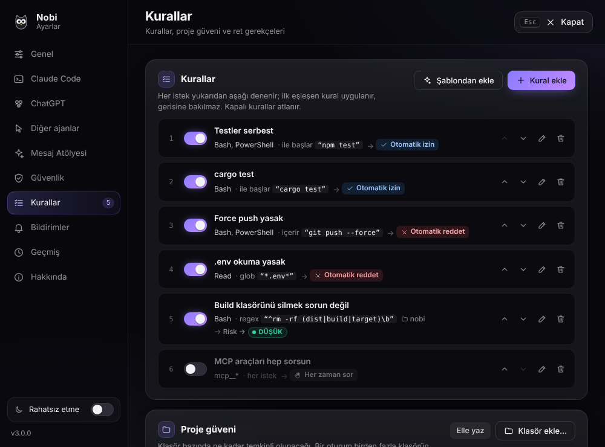
</p>

Kurallar, kart gösterilmeden önce yukarıdan aşağı denenir; ilk eşleşen kazanır — bir yolun
çözülmesi reddetme kuralını hiçbir zaman bir soruya çevirmesin diye tek bir istisnayla: eşleşen ilk
kural bir dosya yolunu yalnızca vardığı yerle (yazıldığı hâliyle değil) yakalamışsa ve reddetmiyorsa,
aşağıda isteği kapsayan bir reddetme kuralı karar verir (kural test alanındaki not ikisinin de adını
verir).

| Bir kural… | Nasıl davranır |
| --- | --- |
| **İzin verebilir** | Sadece otomatik izin tavanına kadar. Daha riskli bir eşleşme yine sana gelir; hangi kuralın izin vermek istediği de yazılır. |
| **Reddedebilir** | Her seviyede. İstek sana hiç gelmez; Claude senin mesajını alır ve başka bir yoldan devam eder. |
| **Her zaman sordurabilir** | Güvenilir bir projenin ya da oturum izninin geçireceği yerde bile. |
| **Yeniden puanlayabilir** | Seviyeyi DÜŞÜK'ten KRİTİK'e kadar ayarlar — yanlış alarmlar için kullanışlı. KRİTİK bir bulgu asla YÜKSEK'in altına inmez, yani yine basılı tutman gerekir. Motorun kendisinin YÜKSEK ya da KRİTİK bulduğu bir istek, kural seviyesini düşürse bile asla otomatik onaylanmaz: tek tıkla onaylanır hâle gelir, sessizce geçmez. |

Desenler nasıl eşleşir:

- **İle başlar** bir kelime sınırında biter: `npm test`, `npm test -- --watch` ile eşleşir,
  `npm testing` ile eşleşmez.
- **Glob** (`*` ve `?`) satır sonlarının da üstünden geçer; böylece komuta eklenen bir satır sonu
  bir yasak kuralını atlatamaz. Düzenleyici glob ve regex desenlerini kuralların kullandığı motorla
  denetler ve hatalı yeri gösterir.
- **İzin veren ya da seviyeyi düşüren bir kural tek bir komutu kapsar.** *İle başlar*, *içerir*,
  glob ya da boş desenle kurulan bir izin kuralı (ya da seviyeyi düşüren bir kural), komut desenin
  kendisinin içerdiğinden fazla komut çalıştırıyorsa eşleşmez: satır sonu, `;`, `&&`, `||`, `|`,
  `&`, ters tırnak, `$(`, `<(` ve `>(` ya da PowerShell, fish ve zsh'in içinde komut çalıştırdığı
  ayraçlar — `( )`, `@( )`, `{ }`, `=( )` ve glob niteleyicileri; böylece `npm test` yanında
  `(iwr …)` taşıyamaz. Regex ile kurulan bir izin kuralı yalnızca eşleştiği kısmı kapsar, komutun
  onun ötesinde çalıştırdığı hiçbir şeyi kapsamaz: `^git status`, `git status; rm -rf ~`'a izin
  vermez. *Tam eşit* desenler tam olarak yazdıklarını söyler; yasaklayan, her zaman sorduran ve
  seviyeyi yükselten kurallar her yerde eşleşir.
- **Boş desen** o aracın her isteğiyle eşleşir ("MCP araçları için her seferinde sor" şablonu buna
  dayanır); her araç için boş desenli bir kuralı kaydetmeden önce düzenleyici seni uyarır.
- **Bir yol, vardığı yer sayılır.** Nobi bir yolun gerçekte nereye vardığını çıkarır: `..`, `.`,
  `~` ve `$HOME` (`%USERPROFILE%`) çözülür, göreli yollar oturumun klasöründen başlar. Bir dosya
  için izin veren ya da seviyeyi düşüren bir kural (ve bir "tekrar sorma" izni) yolla hem yazıldığı
  hâliyle hem de vardığı yerle eşleşmek zorundadır; böylece `..` bir kuralın gösterdiği klasörden
  dışarı tırmanamaz: `Write /work/app/*`, `/work/app/../../etc/hosts`'u kapsamaz; `Write ~/*` da
  aslında `/etc/x` olan `~/../../etc/x`'i kapsamaz. Nobi'nin yerini bilemediği bir klasörün
  (başka bir kullanıcının `~bob`'u, `%APPDATA%`) üstüne tırmanan bir yol böyle bir kuralla asla
  geçmez. Yasaklayan, her zaman sorduran ve seviyeyi yükselten kuralların ise yolla yazıldığı ya da
  vardığı hâliyle eşleşmesi yeter; böylece klasörlerine tırmanarak giren bir yolu da yakalarlar ve
  projeye göre yazılmış böyle bir kural (`src/secrets/*`) aynı dosyayı tam yoluyla yazıldığında da
  yakalar. Bu kurallar yolun şu başka yazılışlarıyla da eşleşir: baştaki fazladan eğik çizgiler
  (`//etc/x`), Linux'ta bir sürecin kök klasörü (`/proc/self/root/etc/x`), macOS'ta `/private/etc/x`,
  Windows aygıt ve nesne yöneticisi yolları (`\\?\C:\x`, `\\.\C:\x`, `\??\C:\x`,
  `\\?\UNC\sunucu\paylasim\x`), bu bilgisayarın yönetim paylaşımları (`\\localhost\C$\x`,
  `\\127.0.0.1\C$\x`), Windows adlarının sonundaki nokta, boşluk ve `::$DATA` (`C:\Windows.\x`) ve
  kuralın adını verdiği bir klasörün ya da dosyanın 8.3 kısa adı (`C:\Program Files\*` için
  `C:\PROGRA~1\x`). Başkası değil: bağlantılar (symlink), junction'lar, bağlama noktaları, subst
  sürücüleri, bilgisayarın kendi adıyla ulaşılan paylaşımlar ve kuralın adını vermediği klasörlerin
  kısa adları izlenmez; bir komut kuralı da komutun metniyle yazıldığı gibi eşleşir. Göreli bir yol
  için "tekrar sorma" izni yalnızca o dosyayı kapsar, başka bir klasördeki aynı adı değil; bir Glob
  isteği de klasörünün altına yazılmış deseniyle (`/work/app/src/**/*.rs`) gösterilir ve
  eşleştirilir.

Şablonlar iyi bir başlangıç: `npm test`'e ve salt okuyan git komutlarına izin ver, `git push --force`
ve paket yayınlamayı yasakla, Claude'u `.env` dosyalarından uzak tut, `rm -rf`'yi her zaman
KRİTİK say, MCP araçları için her seferinde sor.

**Proje güveni** (Ayarlar → Kurallar) — *güvenilir*: DÜŞÜK istekler tavan izin veriyorsa
kendiliğinden geçer; *normal*: varsayılan; *sıkı*: her istek bir seviye yüksek sayılır (ORTA
YÜKSEK'e, YÜKSEK KRİTİK'e çıkar). İç içe klasörlerde en özel olan geçerlidir. Tırnak ya da
boşluklarla yapıştırılan veya içe aktarılan bir klasör (`"C:\src\app"`) önce temizlenir.

**Otomatik izin tavanı** (Ayarlar → Güvenlik) — *Kapalı*, *Sadece DÜŞÜK* (varsayılan) ya da
*DÜŞÜK + ORTA*. Kuralların, güvenilir projelerin ve oturum izinlerinin sensiz onaylayabileceği en yüksek riski
belirler. YÜKSEK ve KRİTİK asla otomatik onaylanmaz: sınır Rust'ta durur ve elle düzenlenmiş bir
ayar dosyası onu kaldıramaz.

### Geçmiş

<p align="center">
  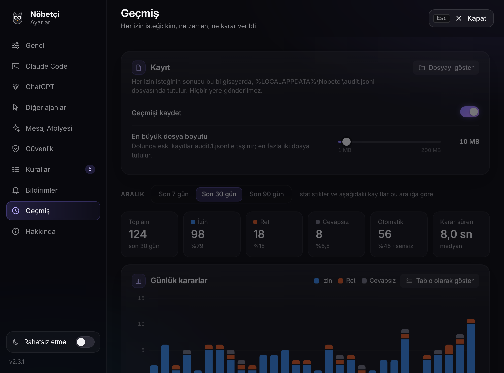
</p>

Her izin isteği kayda geçer: ne zaman, hangi proje ve araç, hedef (en fazla 4.000 karakter, sırlar
maskeli), risk ve bulgular, karar, kararı kimin verdiği ve ne kadar sürdüğü — süresi dolan,
terminale giden ya da cevabı Claude Code'a hiç ulaşmayan istekler dahil. Arayabilir (`İ`, `I`, `ı`
ve `i` aynı harf sayılır; `İNFRA` yazınca `infra-scripts` de bulunur), filtreleyebilir, günlük
grafiklere — gün, yaz saati geçişleri dahil senin yerel takvim günündür — ve en sık görülen
projelere, bulgulara ve araçlara bakabilirsin; eşleşen her şeyi CSV ya da JSON olarak dışa
aktarabilirsin. CSV virgülle ya da — noktalı virgül bekleyen dillerdeki tablo programları için
(örneğin Türkçe Excel) — noktalı virgülle ayrılır ve açması güvenlidir: formül gibi okunacak
hücreler etkisiz hâle getirilir.

Geçmiş, Nobi'nin veri klasöründeki `audit.jsonl` dosyasında durur (bkz.
[Geliştirme](#geliştirme)); dosya 10 MB'a ulaşınca (ayarlanabilir) eski kayıtlar `audit.1.jsonl`'e
taşınır. **Ayarlar → Geçmiş**'ten kapatılabilir ya da temizlenebilir. Bozuk bir satır dosyanın
tamamını değil yalnız kendini kaybettirir; macOS ve Linux'ta dosyayı yalnız senin hesabın okuyabilir.
Unix izinleri olmayan bir dosya sistemi (FAT, exFAT, bazı ağ paylaşımları) bunun dışındadır: orada
Nobi klasörü olduğu gibi kullanır ve bunu kayıt dosyasına yazar.

### Kısayollar

| Eylem | Varsayılan |
| --- | --- |
| Adayı aç ya da kapat | `Ctrl+Alt+N` |
| Karttaki isteği reddet | `Ctrl+Alt+D` |
| Karttaki isteğe izin ver | Atanmamış — sadece DÜŞÜK riskli istekler |
| Rahatsız etmeyi aç / kapat | Atanmamış |
| Asistanı aç | `Ctrl+Alt+Space` |

Mac'te Ctrl, ⌃ Control; Alt, ⌥ Option tuşudur. Kısayollar her pencerede çalışır (Linux'ta bir
Wayland oturumunda yalnız bir X11 penceresi odaktayken). Her program klavye vuruşu taklit edebilir;
bu yüzden izin kısayolu varsayılan olarak kapalıdır ve — Rust tarafından zorlanarak — risk
motorunun kendisinin DÜŞÜK'ün üstünde bulduğu hiçbir şeyi, bir kural onu ne yapmış olursa olsun,
onaylamaz. **Ayarlar → Bildirimler**'den değiştirebilirsin. Windows'ta ve Linux'ta bir harf,
klavye düzeninin tuşun üstüne yazdığı harftir; macOS ise kısayolu tuşun yerine bağlar, bu yüzden
orada harfler ABD klavyesindeki adlarıyla görünür.

### Sessizlik

**Rahatsız etme** (adadaki ay butonu, tepsi menüsü ya da kısayol), **sessiz saatler** (örneğin
23:00–08:00) ve **tam ekranda sessiz** (varsayılan olarak açık; oyun, sunum ve tam ekran video
için). Sessizken ses çalmaz, bildirim gelmez, ada kendiliğinden açılmaz — ama istekler yine sıraya
girer ve kompakt ada bekleyen bir istek olduğunu söyler. Başlangıcı ve bitişi aynı olan sessiz
saatler hiç sessizlik demektir; bütün gün sessizlik için Rahatsız etme'yi kullan.

## Güvenlik modeli

Nobi ikinci bir göz, bir sandbox değil. Risk motoru sezgisel kurallardan oluşur: bariz olanı
ve klasik olanı yakalar, kararlı bir saldırgan onu atlatabilir; DÜŞÜK "belirgin bir şey yok"
demektir, asla "güvenli" değil. Kattığı şey görünürlük, tehlikeli işlerde bilinçli bir yavaşlama
ve okuyabileceğin gerekçelerdir.

<p align="center">
  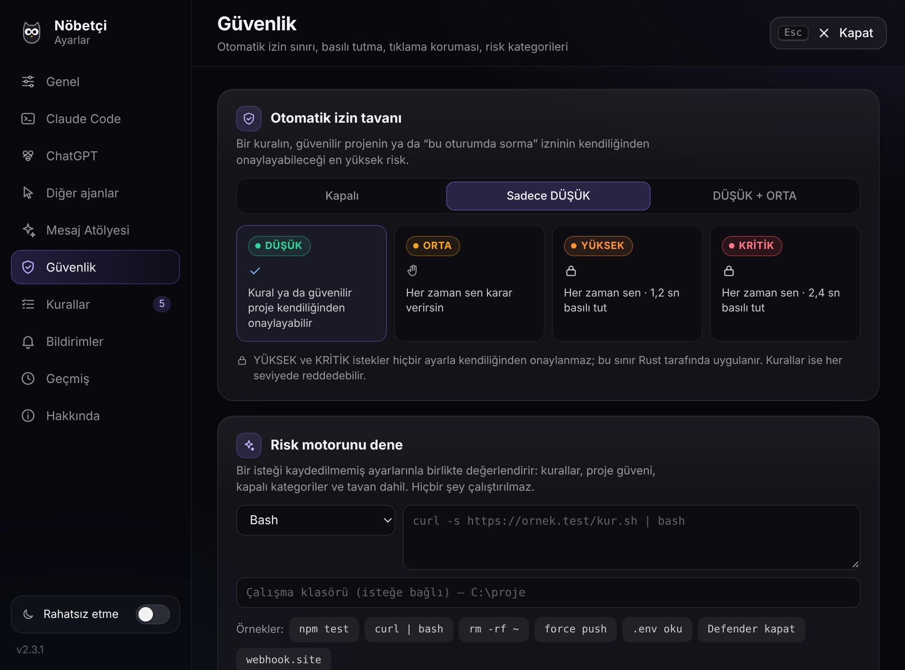
</p>

Özen gösterdiği şeyler: kart tam olarak neyin çalışacağını gösterir; YÜKSEK ve KRİTİK onaylar
Rust'ın zorladığı bir basılı tutma ister; onaylar "İzin ver" butonunun üzerinde yapılmış fiziksel
bir fare tıklamasından gelmelidir — bir tıklama, bir onay, az önce açılmış bir kartta asla — yani
bir betik ajan adına "İzin ver"e basamaz (Linux'ta X11 bir programın gerçek fare üzerinden
tıklamasına izin verdiği için bu denetim orada yalnızca bir yavaşlatıcıdır; YÜKSEK ve KRİTİK
istekler orada terminalde onaylanır); relay ile uygulama sadece senin hesabının açabildiği bir
named pipe (Windows) ya da Unix soketi (macOS, Linux) üzerinden konuşur ve relay karşı uçtaki
uygulamanın senin hesabınla çalıştığını denetler; Nobi'nin kendi dosyalarını değiştirmek,
relay'ini değiştirmek ya da hook'larını kaldırmak her sistemde KRİTİK sayılır; geçmiş sırları
maskeler, CSV dışa aktarımı formül enjeksiyonuna karşı korumalıdır.

Yapamadıkları: zaten senin hesabınla çalışan bir zararlıyı durdurmak, terminalde verdiğin onayları
görmek ya da her sahte girdiyi gerçeğinden ayırmak. Tehdit modelinin tamamı ve bir güvenlik
açığını nasıl bildireceğin için [SECURITY.md](SECURITY.md)'ye bak.

## SSS

**Claude Code'u yavaşlatır ya da bloklar mı?**
Hayır. Relay küçük, yerel bir program: bağlanır, olayı teslim eder ve çıkar; kesin 2 saniyelik
bir bütçesi vardır, pratikte çok daha azını kullanır (**Sağlık testi** senin makinendeki
gidiş-dönüş süresini gösterir). Nobi çalışmıyorsa relay hemen çıkar. Sadece izin istekleri
bekler; o da sadece kart gerçekten ekranındayken ve terminal devralmadan önce en fazla 110 saniye.

**Bir yere veri gönderiyor mu?**
Nobi telemetri, hata raporu, güncelleme denetimi ya da hesap kullanmaz. **Ayarlar → Mesaj
Atölyesi**'nde Ollama varsayılan olarak yerel servise bağlanır; **cloud** etiketli Ollama modelleri
taslağı dışarı iletebilir. OpenAI'yi seçip **Mesajı iyileştir** dediğinde yalnızca o anki taslak
OpenAI API'sine gönderilir. Nobi mesajı ajana iletmez ve geçmişe kaydetmez. Asistanın
**Burada** seçeneği aynı sağlayıcıyı kullanır; hava durumu kartı da seçtiğin şehri Open-Meteo'ya
sorar. Hepsini [gizlilik politikası](PRIVACY.md) sayar.

**Nobi kapalıysa, duraklatılmışsa ya da çökerse ne olur?**
Claude Code ve Codex, Nobi hiç kurulmamış gibi devam eder: dinleyen kimse yoksa (ya da ada
duraklatılmışsa) relay çıktı vermeden çıkar ve terminalde sorarlar. Cursor sana kendisi sorar.
Engelleyen tek durum, relay'i hiç çalışamayan bir Cursor hook'udur — bkz. [Kaldırma](#kaldırma).

**Kaldırınca ne olur?**
Windows'ta kaldırma programı `nobi.exe --remove-hooks` komutunu çalıştırır; bu da
`~/.claude/settings.json`'dan ve Codex'in ve Cursor'un `hooks.json` dosyalarından sadece
Nobi'nin girdilerini siler — her dosyanın yanına tarihli bir yedek bırakarak — ve başka hiçbir
şeye dokunmaz. Mac'te ve Linux'ta bunu senin yerine yapacak bir kaldırma programı yok; uygulamayı
silmeden önce aynı komutu çalıştır (ya da bağlantıları Ayarlar'dan kaldır). Bkz.
[Kaldırma](#kaldırma).

**macOS'ta çalışır mı? Linux'ta?**
İkisinde de evet. macOS 11 ve üstünde ada menü çubuğunun altında, hiç odak çalmayan bir panel
olarak durur; tam ekranda sessizlik çalışır; **Pencereye git** belirli bir pencereyi değil oturumun
uygulamasını öne getirir. Linux'ta ada X11'de (bir bileşikleştiriciyle) ya da XWayland üzerinden
Wayland'de çalışır; Wayland'de genel kısayollar, **Pencereye git** ve tam ekranda sessizlik yalnız
X11 pencerelerini görür. Medya kartı MPRIS destekleyen her oynatıcıyla çalışır. Linux'ta YÜKSEK ve
KRİTİK istekler adada değil, terminalde onaylanır.

**macOS neden açmayı reddediyor?**
Sürümler henüz Apple tarafından onaylanmıyor (notarize edilmiyor). SHA-256'yı doğrula, sonra bir
kereliğine **Sistem Ayarları → Gizlilik ve Güvenlik → Yine de Aç** ile aç.
[Kurulum kılavuzu](docs/kurulum.md#macos) adım adım anlatıyor.

**SmartScreen ya da Defender neden uyarıyor?**
Kurulum dosyası henüz kod imzalı değil, bu yüzden SmartScreen'de itibarı yok. SHA-256'yı sürümle
karşılaştır, ardından **Ek bilgi → Yine de çalıştır**'ı seç. Microsoft Defender bir sürümü
işaretlerse lütfen [bir issue aç](https://github.com/tahap0l/nobi/issues); dosyayı Microsoft'a
yanlış pozitif olarak bildirmek de işe yarar.

**VS Code, Cursor, Windows Terminal, Terminal.app ya da iTerm2 ile çalışır mı?**
Evet. Nobi doğrudan Claude Code'a bağlandığı için oturumun nerede çalıştığı fark etmez.
**Pencereye git**, oturumun süreç zincirini izleyerek yaşadığı pencereyi (Mac'te uygulamayı)
bulur; bulamazsa proje klasörünü açar.

**Claude kendi isteklerini Nobi üzerinden onaylayabilir mi?**
Ada üzerinden hayır: onaylar fiziksel bir tıklamadan gelmeli, izin kısayolu varsayılan olarak
kapalı ve sadece DÜŞÜK risk için, YÜKSEK ve KRİTİK ise basılı tutma istiyor — Linux'ta, bir program
gerçek fare üzerinden tıklayabildiği için, bunlar adada hiç onaylanamıyor. Ama onaylanmış bir
komutun başlattığı her şey senin yetkilerinle çalışır ve örneğin Claude Code'un ayarlarını,
Nobi'nin kendi ayarlarını değiştirebilir ya da hook'larını kaldırabilir — tam da bu yüzden böyle
istekler KRİTİK sayılır. Ayrıntılar [tehdit modelinde](SECURITY.md).

**Claude masaüstü uygulamasında zaten izin verdiğim komutlar neden adayı bekliyor?**
Masaüstü uygulaması Claude Code'un `PermissionRequest` hook'unu hiç çalıştırmaz; bu yüzden Nobi,
uygulamanın kendi izin denetiminden önce gelen ve Claude'daki izin listeni göremeyen `PreToolUse`
üzerinden sorar. Kimsenin cevaplamadığı bir istek en fazla 108 sn bekler, sonra uygulama normalde
nasıl karar verecekse öyle karar verir. Böyle bir oturumu başında kimse olmadan bırakmadan önce
Nobi'yi duraklat ya da DÜŞÜK istekleri güvenilir bir proje veya kurallarla geçir.

## Kaldırma

Nobi'nin hook'ları başka programların ayar dosyalarında durur: Claude Code için
`~/.claude/settings.json`, bağladıysan Codex'in `hooks.json` dosyası (`$CODEX_HOME` içinde ya da
`~/.codex` altında) ve `~/.cursor/hooks.json`. Uygulamayı silmeden önce onları çıkar. Relay yerinde
durduğu sürece unutulan bir hook zarar vermez: Claude Code ve Codex her zamanki gibi sorar, Cursor da
sana kendisi sorar. Ama relay silinince Claude Code her adımda bir hook hatası bildirir; Cursor ise —
Nobi izin hook'larını güvenli tarafta kapanacak (fail-closed) biçimde kurduğu için — girdiler
kaldırılana kadar her kabuk ve MCP komutunu engeller.

`nobi --remove-hooks` üç dosyadan da yalnızca Nobi'nin kendi girdilerini kaldırır; diğer
ayarlara ve başka araçların hook'larına dokunmaz, her dosyanın yanına tarihli bir yedek bırakır
(`settings.json.bak-…`, `hooks.json.bak-…`). Fark göstermez — kaldırma programının komutudur — ama
macOS'ta ve Linux'ta terminalde her dosya için bir satır yazar; temizleyemediği bir dosya olursa da
1 koduyla çıkar. Windows'ta konsolu yoktur: neyi kaldırdığı ya da kaldıramadığı
`%LOCALAPPDATA%\Nobi\nobi.log` dosyasına yazılır, çıkış kodunu da kaldırma programı okur. (Bir
ajan onu çalıştırmak isterse Nobi bunu KRİTİK sayar: onu yalnız sen çalıştırmalısın.) Her
değişikliği incelemek istersen **Ayarlar → Claude Code → Kaldır…**, **Ayarlar → ChatGPT →
Bağlantıyı kaldır…** ve **Ayarlar → Diğer ajanlar → Bağlantıyı kaldır…** düğmelerini kullan.

### Windows

**Ayarlar → Uygulamalar → Yüklü uygulamalar**'ı (Windows 10'da **Uygulamalar ve özellikler**)
aç, **Nobi**'yi bul ve **Kaldır**'ı seç. Kaldırma programı:

1. Nobi açıksa kapatmanı ister — orada **İptal** her şeyi olduğu gibi bırakır;
2. Claude Code, Codex ve Cursor dosyalarında `nobi.exe --remove-hooks` (yukarıda) çalıştırır;
3. uygulamayı, relay'i (`%LOCALAPPDATA%\Nobi\bin`), kayıt dosyasını, **Windows açılınca
   başlat**'ı ve [ChatGPT Web köprüsünü](integrations/chatgpt-web/README.tr.md) kurduysan onun
   Chrome ve Edge'deki kaydını kaldırır (eklentinin kendisini tarayıcıdan sen kaldırırsın).

Hook'lar kaldırılamazsa relay ve kayıt dosyası yerinde kalır; böylece Claude Code, Codex ve Cursor
çalışmaya devam eder ve bir mesaj hangi girdileri elle sileceğini söyler.

Tercihlerin ve ajandan (`%APPDATA%\Nobi`) ve geçmişin (`%LOCALAPPDATA%\Nobi\audit.jsonl`)
yerinde kalır; yeniden kurarsan kaldığın yerden devam edersin. Bunları da silmek için kaldırma
programında **Uygulama verilerini sil** kutusunu işaretle. Kurulu sürümün üstüne daha yeni bir
sürüm — ya da 2.4.1'den yeni bir kurulum programıyla daha eski bir sürüm — kurmak kaldırma değil
güncellemedir: hook'lar, **Windows açılınca başlat** ve veriler kalır. 2.4.1'e ya da daha eskisine
dönüp bunları korumak için onun kurulum programının gösterdiği sayfada **Kaldırma işlemini
gerçekleştirme**'yi seç ([ayrıntılar](docs/kurulum.md#8-güncelleme)).

### macOS

1. Terminal'de `/Applications/Nobi.app/Contents/MacOS/nobi --remove-hooks` çalıştır — ya da
   yukarıdaki gibi her bağlantıyı Ayarlar'dan kaldır.
2. **Oturum açınca başlat** açıksa **Ayarlar → Genel**'den kapat.
3. Nobi'den menü çubuğundan çık ve onu Uygulamalar'dan Çöp Sepeti'ne taşı.

Tercihlerin, ajandan, geçmişin ve relay `~/Library/Application Support/Nobi` klasöründe kalır;
hiç iz kalmasın istiyorsan o klasörü de sil.

### Linux

1. `nobi --remove-hooks` (`.deb`) ya da `./Nobi-x.y.z-linux-amd64.AppImage --remove-hooks`
   çalıştır — ya da yukarıdaki gibi her bağlantıyı Ayarlar'dan kaldır.
2. **Oturum açınca başlat** açıksa **Ayarlar → Genel**'den kapat
   (`~/.config/autostart/Nobi.desktop` dosyasıdır).
3. Nobi'den tepsiden çık, sonra `sudo apt remove nobi` çalıştır ya da AppImage'ı sil. Paket
   yöneticisi root olarak çalışır ve hook'ları senin ev klasöründen çıkaramaz; 1. adımın önce
   gelmesi bu yüzden.

Ayarlar ve ajanda `~/.config/nobi`, geçmiş, kayıt dosyası ve relay `~/.local/share/nobi`,
soketin klasörü `~/.local/state/nobi` altında kalır; hiç iz kalmasın istiyorsan üçünü de sil.

## Geliştirme

```powershell
npm run dev          # önce relay'i derler (Rust gerekir), sonra sadece arayüz, tarayıcıda, demo verilerle
npx vite             # relay'i derlemeden aynı tarayıcı önizlemesi: Rust gerekmez
npm run tauri dev    # gerçek uygulama, canlı yenilemeyle
npm test             # Rust testleri
npm run lint         # clippy (uyarılar hata sayılır) ve TypeScript tip denetimi
npm run pack         # Windows kurulum dosyası, release\ klasörüne
npm run pack:store:offline # Store uyumlu çevrimdışı Windows paketi, release/store\ klasörüne (imzasız)
npm run pack:mac     # macOS disk görüntüsü (universal), release/ klasörüne
npm run pack:linux   # .deb ve AppImage, release/ klasörüne
```

Geliştirme sunucusu çalışırken:

- `http://127.0.0.1:1420/?demo=critical` adayı sahte oturumlar ve isteklerle gösterir. Diğer
  demolar: `low`, `medium`, `write`, `hidden`, `deny-menu`, `batch`, `question`, `plan`,
  `overview`, `session`, `assistant`, `compact`, `empty`, `tour`, `mascots`, `reactions`,
  `installer-art`. Adada başka bir maskotu görmek için `&theme=wolf` (ya da başka bir maskot) ekle.
- `http://127.0.0.1:1420/settings.html?tab=kurallar` Ayarlar'ı sahte verilerle açar. Sekmeler:
  `genel`, `claude`, `chatgpt`, `ajanlar`, `prompts`, `guvenlik`, `kurallar`, `bildirimler`,
  `gecmis`, `hakkinda`; hoş geldin sihirbazı için `hosgeldin`.
- Dili seçmek için `&lang=tr` ya da `&lang=en` ekle. Ayarlar'da `&platform=macos` ya da
  `&platform=linux` Mac ya da Linux metinlerini gösterir.
- Tarayıcı konsolunda `nobi.inject({ … })` adaya sahte bir hook olayı gönderir.

```text
hook/                  nobi-hook — Claude Code, Codex ve Cursor'un her hook olayında çalıştırdığı relay
  src/win.rs · mac.rs · linux.rs   named pipe (Windows) / Unix soketi (macOS, Linux), üst süreç zinciri
  src/browser.rs       ChatGPT Web köprüsünün native-messaging sunucusu
src-tauri/src/
  risk.rs · risk/      risk motoru, kategoriler ve kabuk komutlarının okunması (+ testler)
  rules.rs             kullanıcı kuralları, proje güveni, oturum izinleri (+ testler)
  pipe.rs              relay sunucusu ve onay kararları
  pipe/                named_pipe.rs (Windows) · unix_socket.rs (macOS, Linux)
  audit.rs             geçmiş, istatistik, CSV/JSON dışa aktarma (+ testler)
  redact.rs            geçmiş ve bildirimler için sır maskeleme
  inputguard.rs        fiziksel tıklama koruması
  inputguard/          raw_input.rs (Windows Raw Input) · appkit.rs (macOS olay kaynağı) · x11.rs (XInput2)
  hooks.rs             ~/.claude/settings.json kurulumu ve kaldırılması (fark + yedek)
  agent_hooks.rs       Codex ve Cursor için aynısı
  settings.rs          tercihler ve sınırları
  island.rs            şeffaf, tıklama geçirgen ada penceresi
  sys.rs               işletim sistemine göre küçük yardımcılar: saat, dil, tam ekran, ev klasörü
  widgets.rs · widgets/  adanın kartları için medya, sistem yükü ve hava durumu
  agenda.rs · assistant.rs · buddy.rs · prompts.rs
  quiet.rs · focus.rs · hotkeys.rs · tray.rs · i18n.rs · x11.rs · mac_panel.rs
src/
  baykus/              maskotlar, selamlamaları ve mini kafalar (Canvas 2D)
  island/              durum makinesi, hook olayları, geometri
  ui/                  ada görünümleri, onay kartı dahil
  core/                durum, Rust köprüsü, sentez sesler
  buddy/               masaüstü maskotu
  settings/            ayarlar penceresi
  i18n/                Türkçe ve İngilizce metinler
scripts/               kurulum paketleme, ikon üretici, ekran görüntüleri, denetimler
```

| Ne | Windows | macOS | Linux |
| --- | --- | --- | --- |
| Tercihler, ajanda | `%APPDATA%\Nobi\` | `~/Library/Application Support/Nobi/` | `~/.config/nobi/` |
| Geçmiş | `%LOCALAPPDATA%\Nobi\audit.jsonl` (+ `audit.1.jsonl`) | `~/Library/Application Support/Nobi/audit.jsonl` | `~/.local/share/nobi/audit.jsonl` |
| Kayıt dosyası | `%LOCALAPPDATA%\Nobi\nobi.log` | `~/Library/Application Support/Nobi/nobi.log` | `~/.local/share/nobi/nobi.log` |
| Relay | `%LOCALAPPDATA%\Nobi\bin\nobi-hook.exe` | `~/Library/Application Support/Nobi/bin/nobi-hook` | `~/.local/share/nobi/bin/nobi-hook` |
| Claude Code hook'ları | `%USERPROFILE%\.claude\settings.json` | `~/.claude/settings.json` | `~/.claude/settings.json` |

Claude Code ayarlarının yedekleri yanlarında `settings.json.bak-*`, Codex'in ve Cursor'unkiler
`hooks.json.bak-*` adıyla durur. Linux'ta `$XDG_CONFIG_HOME` ve `$XDG_DATA_HOME` tanımlıysa ilk iki
klasör onlara göre yer değiştirir.

Katkılara açığız — kurulum, temel kurallar ve yanlış pozitif bildirimi için
[CONTRIBUTING.md](CONTRIBUTING.md)'ye bak (İngilizce).

## Yol haritası

Söz değil, fikir:

- **İmzalı Windows sürümleri**, SignPath Foundation üzerinden — sürüm iş akışı hazır; bkz.
  [kod imzalama politikası](CODE_SIGNING_POLICY.md).
- **Apple onaylı (notarize) macOS sürümleri**, Gatekeeper dolambaçsız açsın diye. Proje bir Apple
  Developer ID aldığında sürüm iş akışı imzalayıp onaya göndermeye hazır.
- **Daha çok ajan** — hook ya da izin API'si sunan başka kodlama ajanları ve Codex'in ve Cursor'un
  yaptıklarının daha fazlası için izin istekleri.
- **Yerel bir Wayland adası**; kısayollar, **Pencereye git** ve tam ekranda sessizlik her pencereyi
  görsün diye.
- **Daha yetenekli bir asistan**: daha çok uygulama, Linux'ta sesle yazma, ekranda kalan yanıtlar.
- **Daha keskin kurallar** — daha geniş kapsam, daha az yanlış pozitif. Bildirimlerin çok değerli.

## Lisans

[MIT](LICENSE). Üçüncü taraf bildirimleri için [NOTICE.md](NOTICE.md)'ye bak.
